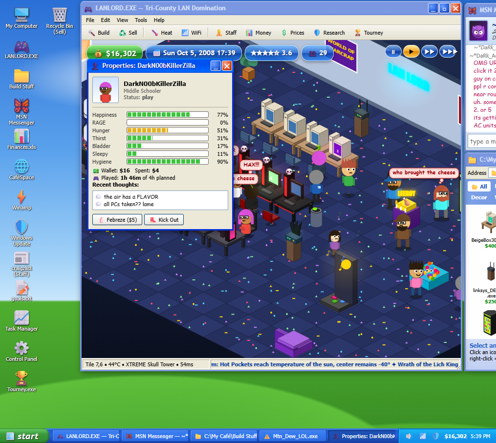
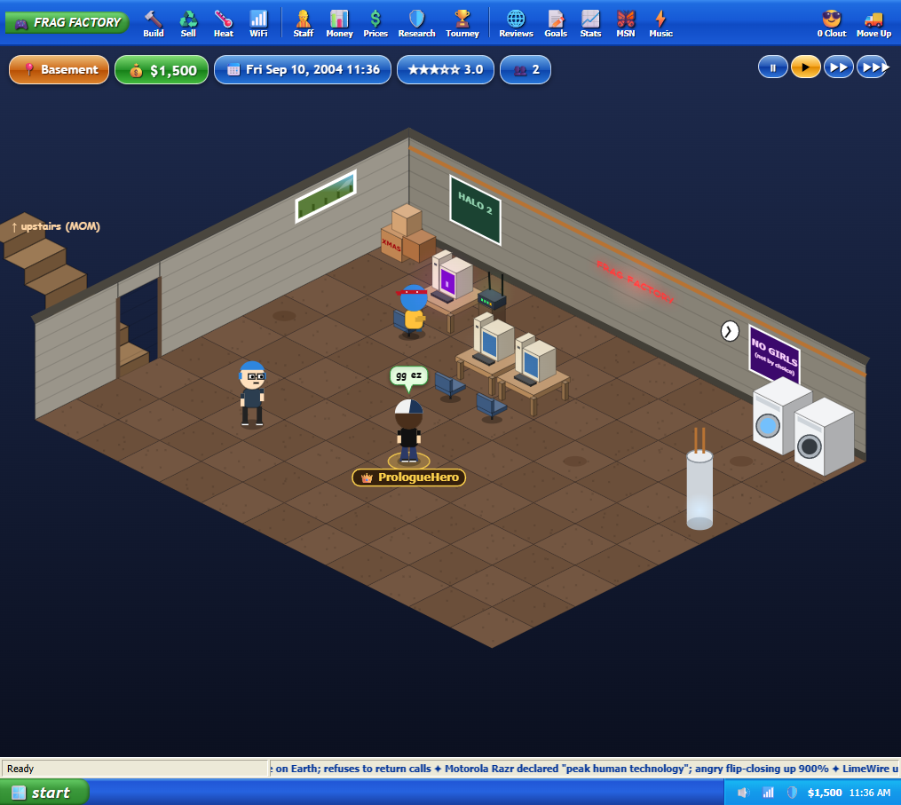

# 🎮 LAN LORD XP

**A fully absurd 2004–2012 LAN café tycoon that runs in your browser.**
Drop out of community college. Start a LAN party in your mom's basement. Survive LimeWire viruses, BonziBUDDY, raging 12-year-olds, health inspectors and Mom. Grow it into an eSports **TOWER**.

### ▶️ [PLAY NOW: colinpassman5-hash.github.io/lan-lord-xp](https://colinpassman5-hash.github.io/lan-lord-xp/)
*Free. No install. Open source. Community built.*



## What's in it
- 🎬 **Split-screen cinematic prologue.** Create your 2004 self (frosted tips, JNCOs, Von Dutch trucker, puka shells), name your LAN, pick a starter PC (GRASS / FIRE / WATER type), and get rival-IM'd on AIM.
- 🏠 **Five chapters (prestige).** Mom's Basement → Strip Mall → The Old Blockbuster → Warehouse Arena → LAN LORD TOWER. Earn **Clout** and buy permanent perks.
- 🔥 **Real tycoon systems:** heat (PCs catch fire), WiFi and ping (lag → rage → smashed keyboards), customer needs (bladders are real), Buzz (word of mouth), staff, research via "Windows Update", tournaments.
- 🧍 **Customers with brains:** a first-come-first-served line, seat saving (jacket on chair + BRB note), clans that sit together, trash talk and cheering.
- 🍋 **LimeWire.exe:** free music that's usually mislabeled (a screaming goat) and occasionally ships BonziBUDDY to your café PCs.
- ⚡ **Winamp** with 15+ original songs synthesized live in the browser: keygen tunes, crunk, pop-punk, GeoCities MIDI ballads.
- 🖥️ The entire UI is a love letter to Windows XP, MSN Messenger, MySpace and Excel.



## 📮 Feedback → the dev
Use the **📮 Dev Notes** button in the game's top bar. It attaches your game state automatically and opens a GitHub issue, or lets you post it on X. You can also [open an issue](https://github.com/colinpassman5-hash/lan-lord-xp/issues/new/choose) directly.

## 🛠️ Community build: come build it with us
Anyone can contribute, from one-line jokes to whole chapters. Start here: **[CONTRIBUTING.md](CONTRIBUTING.md)**
```bash
git clone https://github.com/colinpassman5-hash/lan-lord-xp.git
cd lan-lord-xp && npm install && npm run dev
```
Good first contributions: customer thoughts, CaféSpace reviews, Mom yells, LimeWire files, clan tags, new items drawn in code, and original parody music.

## How it was made
Built by a human with an AI dev team: a lead dev agent plus specialist agents for music, props, writing, art, QA metrics and playtesting. Everything runs client-side:
- **TypeScript + Vite**
- **Canvas2D** isometric renderer, with all art drawn in code
- **WebAudio** synth, so there are no audio files
- **No backend**, which means it's playable anywhere

## Legal-ish
- All music and melodies are original. Band names and song titles are parodies.
- "Macrohard", "LimeWire PRO (not actually PRO)" and friends are jokes. No affiliation with any real company is implied.
- Code is released under the [MIT License](LICENSE).
